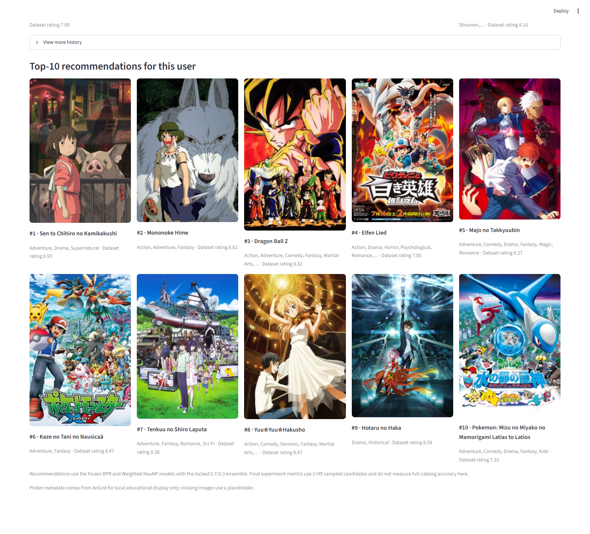

# Recommender systems (SC4020)

An undergraduate course project comparing four recommendation approaches on Anime and MovieLens 1M.
This repository contains the implementations, experiment configurations, recorded results and a Streamlit demo.

[Run experiments](EXPERIMENTS.md) · [Results and comparison scope](docs/RESULTS.md) · [Demo setup](demo/README.md)

## Quick start

Use Python 3.11 or 3.12 and run commands from the repository root.
Create and activate a virtual environment, then install:

```bash
python -m venv .venv
```

Activate with `.venv\Scripts\Activate.ps1` in PowerShell or `source .venv/bin/activate` in Bash.

```bash
python -m pip install -e ".[dev,notebooks,demo]"
python -m pytest
```

Tests use small synthetic inputs; downloading datasets or training models is unnecessary.
See [experiment instructions](EXPERIMENTS.md) to run each method with the original datasets.

## Methods and contributions

| Method | Owner | Main entry point |
| --- | --- | --- |
| Content-based filtering | Siyuan | [Anime notebook](content_collab/anime_dataset/content_based_shared_protocol.ipynb), [MovieLens notebook](content_collab/movielens_dataset/2_content_based_movielens.ipynb) |
| User-user neighbourhood | Zhewen | `src/run_user_user_knn.py`, `src/run_user_user_knn_movielens.py` |
| Item-item neighbourhood | Michael | `src/models/item_item.py`, `configs/final/*item_item*` |
| Model-based collaborative filtering | Lijie | `src/train.py`, `src/models/`, `src/ensemble.py` |

## Recorded results

Reported held-out test NDCG@10 for the selected configurations:

| Method | Anime | MovieLens 1M |
| --- | ---: | ---: |
| Content-based | 0.259747 | 0.149743 |
| User-user, K = 50 | 0.6849 | 0.5531 |
| Item-item, K = 50 | 0.714 | 0.538 |
| BPR–Weighted NeuMF ensemble | 0.799658 | 0.632039 |

Anime user-user tests cover 10,000 users; content-based and model-based tests cover 60,384.
Matching content-based and model-based splits and candidates were checked; exact agreement across all four methods remains unverified.
These numbers therefore do not establish a controlled four-method ranking.
See [full results](docs/RESULTS.md) for HR@10, variability and source records.

## Demo

The demo ranks the full warm Anime catalogue for anonymous existing users.
It supports English and Chinese, viewing histories and locally cached posters.



```bash
python -m streamlit run demo/app.py
```

The demo requires a local `demo_bundle/` with trained checkpoints and user histories.
It is excluded from Git; a fresh clone can run tests without it.
See [demo setup](demo/README.md) for bundle preparation.
Sampled test scores above do not measure full-catalogue demo accuracy.

## Repository layout

```text
src/             shared data/evaluation code and collaborative models
content_collab/  content-based notebooks and supporting code
configs/         training and evaluation configurations
demo/            Streamlit interface and offline inference
tests/           automated checks
docs/            results, figures and archived experiment notes
evidence/        recorded metrics and experiment provenance
examples/        earlier prototypes, separate from the reported experiments
ops/             scripts used for the original training runs and figures
```

Datasets, checkpoints, generated predictions and local credentials stay outside Git.
Historical notes in [docs/archive](docs/archive/README.md) describe past experiments; they are optional reading.
