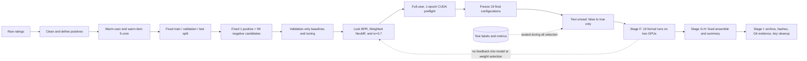
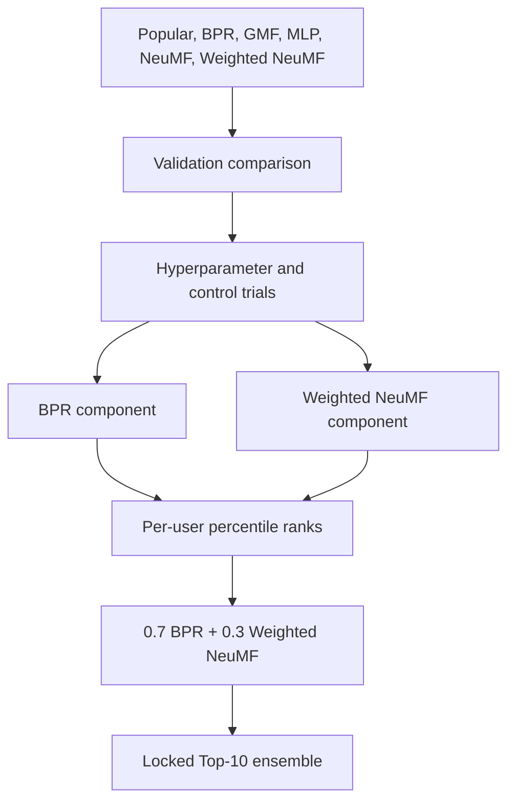

# Anime model-based experiment overview

This records the preparation, model selection and final evaluation of the
Anime model-based methods. The four-method comparison is in the current
[result summary](../RESULTS.md).

## Experiment sequence

Validation selected the models and hyperparameters. Test scoring was enabled
after the candidates, training seeds, ensemble formula and weight were fixed.

## Recorded stages

| Stage | Purpose | Recorded checks |
|---|---|---|
| Data preparation | Fix users, items, splits and candidates | Stable manifest; 60,384 users, 7,223 items, fixed split and candidates |
| Baseline preflight | Check model execution and server resources | Validation-only metrics, finite loss, clean logs |
| Validation tuning | Select settings on validation | Shared 10,000-user development subset; fixed budgets and seeds |
| Candidate lock | Fix the final configurations | BPR, Weighted NeuMF, other comparison models, three seeds, fixed `w=0.7` |
| Full-user preflight | Check execution at full scale on CUDA | 60,384 users, one epoch, two RTX A6000 devices, GPU attach proof |
| Test unseal | Enable test scoring with other settings unchanged | 19 configs changed only from `evaluate_test: false` to `true` |
| Formal Stage F | Check completion of the declared runs | 19/19 schema gates, 18/18 GPU gates, no retry or timeout |
| Ensemble Stage G-H | Compute the fixed blend and compare components | Six derived artifacts and one validated final summary |
| Archive Stage I | Archive source and result records | Commit IDs, SHA-256 values, reports, metadata archive, credential cleanup |

## Data and evaluation

The raw ratings were converted into an implicit-feedback task:

- A rating of at least 7 is a positive interaction.
- Ambiguous duplicate user-item pairs are removed.
- Iterative 5-core filtering retains only warm users and warm items.
- Every eligible user contributes one validation positive and one test positive;
  the remaining positives form training data.
- Every evaluation ranks one held-out positive against 99 fixed unseen
  negatives. Every model receives the same candidates.

The frozen dataset contains 60,384 eligible users, 7,223 warm items, 5,087,394
training positives, 60,384 validation positives, and 60,384 test positives.
The scores measure ranking within sampled 100-item candidate sets for warm
users. Full-catalogue and online performance were not evaluated.

## Model selection

BPR captures pairwise collaborative preference structure. Weighted NeuMF adds
a nonlinear interaction model with confidence weighting. Their raw score
scales are different, so the ensemble first converts each model's scores to
per-user percentile ranks, then combines them with the already selected
`0.7 / 0.3` weights. No ensemble weight was searched after test unsealing.

## Training runs and derived results

The final experiment ran 19 configurations:

- Popular: 1 deterministic run.
- BPR, GMF, MLP, NeuMF, and Weighted NeuMF: 3 seeds each, for 15 runs.
- BPR ensemble components: 3 additional seed-matched runs.

That totals `1 + 15 + 3 = 19`. Stage G-H then derived six ensemble files from
existing predictions: validation and test for each of three seeds. These are
derived results, not six new training runs.

## Test results

| System | Test NDCG@10 | Test HR@10 |
|---|---:|---:|
| Ensemble `w=0.7` | **0.799658 ± 0.000259** | **0.956335 ± 0.000843** |
| Weighted NeuMF | 0.783825 ± 0.000137 | 0.946862 ± 0.003018 |
| BPR | 0.770767 ± 0.000330 | 0.952703 ± 0.000526 |
| NeuMF | 0.765100 ± 0.000851 | 0.947094 ± 0.000734 |
| GMF | 0.716820 ± 0.002421 | 0.935043 ± 0.001161 |
| MLP | 0.716791 ± 0.000522 | 0.936037 ± 0.000538 |
| Popular | 0.507031 | 0.771761 |

The ensemble scored highest on both metrics in each of the three seed runs.
Validation and test scores were close under this fixed sampled-candidate
protocol. Three training seeds describe run-to-run variation; they do not
establish statistical significance.

## Recommendation output

For a warm user and known catalog items, the system outputs a ranked Top-N list
of unseen anime IDs with ranking scores. Turning that into a product-facing list
of titles, posters, or explanations requires joining item metadata and defining
serving rules. A brand-new user with no usable history needs a cold-start
fallback such as popularity or content features; that case is outside this
collaborative-filtering experiment.

## Experiment records

The model-based runs share users, items, splits and candidates. Tuning used
validation only. CUDA configuration, process attachment and monitoring record
the GPU use. Source commits, manifests, schema checks and SHA-256 values identify
the archived inputs and results. Generated data, machine addresses and credentials
are excluded from Git.

For exact final values and caveats, see
[`../evidence/final_result_report_2026-09-05.md`](../../evidence/final_result_report_2026-09-05.md).
